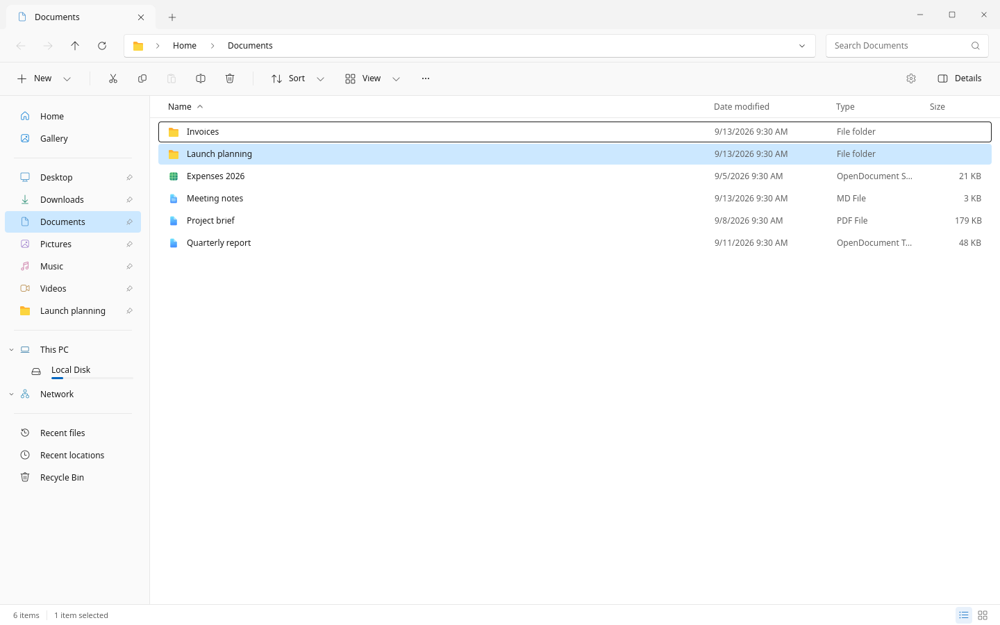
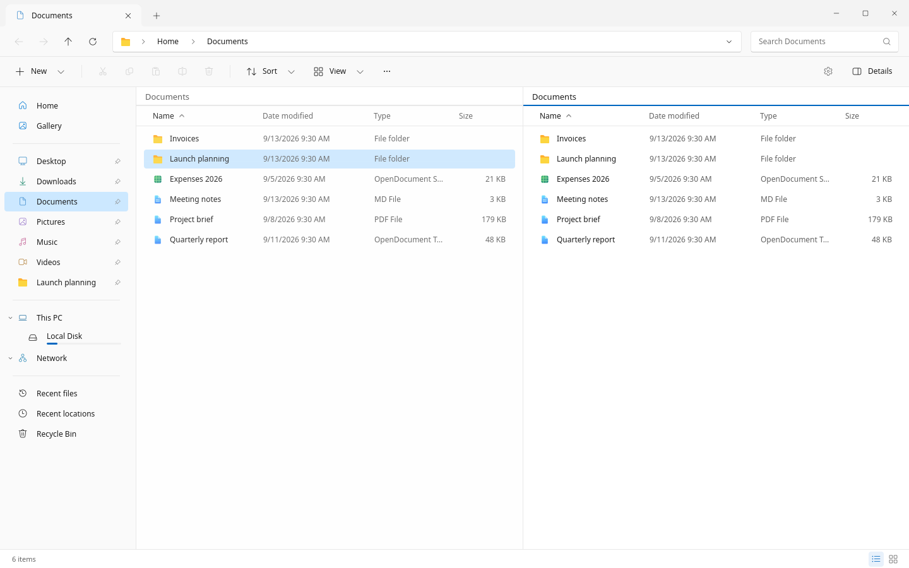

# OpenXplorer

**The Windows 11 File Explorer you know, native on Linux.** Built for Zorin OS first, and at home on Ubuntu, Debian, Fedora, openSUSE, Arch and anywhere Flatpak runs.

**[Website](https://openxplorer.app)** · **[Take the tour](https://openxplorer.app/tour/)** · **[Installation](docs/installation.md)** · **[Documentation](docs/introduction.md)** · **[What's new](CHANGELOG.md)**

## Why OpenXplorer

- **Feels like home.** Windows 11's command bar, tabs you can drag out like Chrome's, split panes, a folder tree, Details, Compact, Tiles, Content and Gallery views, Group by, Folder Options and the keyboard shortcuts your fingers already know.
- **Your whole network in one window.** SMB shares, SFTP, FTP, WebDAV and NFS, with Previous Versions straight from your NAS's snapshots.
- **Find anything fast.** Windows search syntax, content search and an optional filename index that answers instantly.
- **Archives are just folders.** Open ZIP, TAR and 7z files like folders, and make them from **Compress to**.
- **Hard to break.** Undo for file operations, a real Recycle Bin, and previews in separate processes so no damaged file can freeze the window.
- **Your default, everywhere.** Make it the default file manager, including the Open and Save dialogs of other apps.
- **Light and dark**, fast in folders of 100,000 items, free and open source, no account needed.

*The native GTK 4 app, shown with fictional sample files.*

## Get it

Download the [latest release](https://github.com/AKolenda/openxplorer/releases/latest): the `.deb` for Zorin OS 18, Ubuntu 24.04+ and Debian 13, the `.rpm` or `.pkg.tar.zst` for Fedora, openSUSE and Arch, or the Flatpak for everything else. The [installation guide](docs/installation.md) walks through it, and the app tells you when an update is out.

## Build it or contribute

Building from source, working on the code or sending a pull request? Start with [CONTRIBUTING.md](CONTRIBUTING.md). Report vulnerabilities through [SECURITY.md](SECURITY.md).

## License

**[AGPL-3.0-only](LICENSE)**, with documented file-level exceptions. Preserve the upstream Winspace [MIT notice](licenses/Winspace-MIT.txt), [NOTICE](NOTICE) and [third-party notices](THIRD_PARTY_NOTICES.md).

Independent project; not affiliated with Microsoft, Zorin, Canonical, Debian or Vercel. No warranty.
