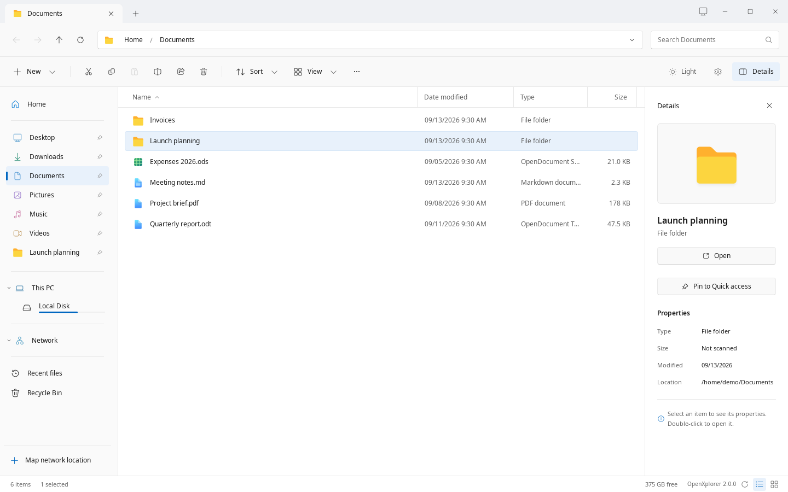

# Introduction

A familiar way to explore. A different kind of ownership.

## Meet OpenXplorer

OpenXplorer is a Windows File Explorer-inspired file manager for Linux, built for Zorin OS and intended to extend to compatible Ubuntu and Debian installations. It brings a familiar tabbed interface to your local folders and SMB shares.

Previously called Winspace, the project is now published as OpenXplorer. The desktop application and this website are distributed under AGPL-3.0-only; original third-party notices remain intact.

*The native app, captured with fictional sample files. No live NAS connection.*

## Your files. Your network. Your workflow.

Navigate with clickable breadcrumbs, pin folders, type to select a filename, resize columns, and use either a classic or compact context menu. Search opted-in filename indexes, browse ZIP contents read-only, and inspect existing exposed snapshots.

The tour below shows pictures of the real native app, captured with fictional sample files: click a control in a picture to see where it leads. It cannot access your computer, NAS, browser settings or keyring. On a desktop-sized screen, use the buttons above the tour to open a scene, switch appearance, or play a short walkthrough. The tour is not loaded on phones; the documentation and screenshots remain available.

- Local files and SMB shares in one interface.
- A searchable Settings page, with explicit controls for desktop integration.
- Source included alongside the installer; no account needed to use the app.

[Open the click-through tour of the real app](../apps/web/public/tour/index.html): pictures of the native app with sample files, no access to your computer.

## Native storage. Local interface.

Since 2.0.0 the desktop app is a native GTK 4 application written in Rust. GIO/GVfs provides the filesystem, SMB and phone layer; SQLite stores the optional filename index. The Python/WebKitGTK app of 1.x is retired; its last release, 1.1.4, stays available as a tag of the public repository. This Next.js website is separate and is not required to run the app; its tour shows pictures of the native app.

## Know what you are installing

Version 2.0.0 replaces the Python app with the native GTK 4 app under the same name, settings and saved passwords, and adds Fluent icons, a categorised Settings page, undo, and Flatpak and distribution packages. Zorin is the primary target; Ubuntu 24.04+, Debian 13, Fedora, openSUSE and Arch are supported through their packages, and every other distribution through the Flatpak. Version 2.0.1 adds split panes, a Compact view, a folder tree, thumbnails, transfer jobs with undo, SFTP, FTP, WebDAV and NFS locations, content search and optional Open and Save dialogs for other apps. Version 2.0.2 opens ZIPs like folders, makes Extract all and the Open and Save dialogs work as in Windows, and adds Windows 11's Compact view and collapsible This PC and Network sections. Version 2.0.3 adds Windows Explorer's Group by, separate from the sort, makes copies ask about a single unreadable file and about names Windows cannot use, and says when a drive is read-only or a tab's drive or share goes away. Version 2.0.4 adds item check boxes as in Windows 11 and a redesigned Settings page, with a search across every page. Version 2.0.5 names copies, drags files and makes new folders as Windows Explorer does, shows Size on disk in Properties, asks before a rename changes an extension, lets Super+E open it on KDE Plasma, and shows an empty folder as Windows does, taking right-click, paste and drops there. Version 2.0.6 lets Brave's downloads, Save as PDF and uploads open OpenXplorer's Open and Save dialogs, and can make Brave ask where to save each download, by default shows an unselected item's check box on hover only while Ctrl is held, as Windows Explorer does, and can index frequently opened folders for instant search (experimental, off by default). Version 2.0.7 sends other apps' Open and Save dialogs, GTK 3 apps' included, to OpenXplorer as part of Make OpenXplorer default, formats removable drives in its own Format dialog, and deletes files on shares faster. Version 2.0.8 adds Windows Explorer's Folder Options, its Ctrl+E, Ctrl+D, F11 and Alt+P keys, and a Share button that emails the selected files, moves deleted items to the Recycle Bin wherever that works, and, as Windows Explorer does, no longer shows a message, an Undo button or a desktop notification after a file operation that succeeds or is cancelled, while failures are still reported. The known gaps are listed in the changelog. Version 2.0.9 keeps a name being renamed in place open through its own right-click menu, and item check boxes are off by default, so a selected item is only highlighted, and a search word found only in a name's extension no longer matches. Version 2.0.10 adds a Simplified Chinese translation, used when the desktop's language is Chinese; every other language stays in English.

> Use a disposable folder and a non-critical share first. SMB servers other than the maintainer's, phones and USB drives have not yet been accepted on real hardware with the native app.

## Start with one folder

Read Installation, open your home directory, and test a network share. Enable indexing and default-file-manager integration only after checking basic file operations.

---

OpenXplorer 2.0.10. Project-authored documentation: AGPL-3.0-only.
