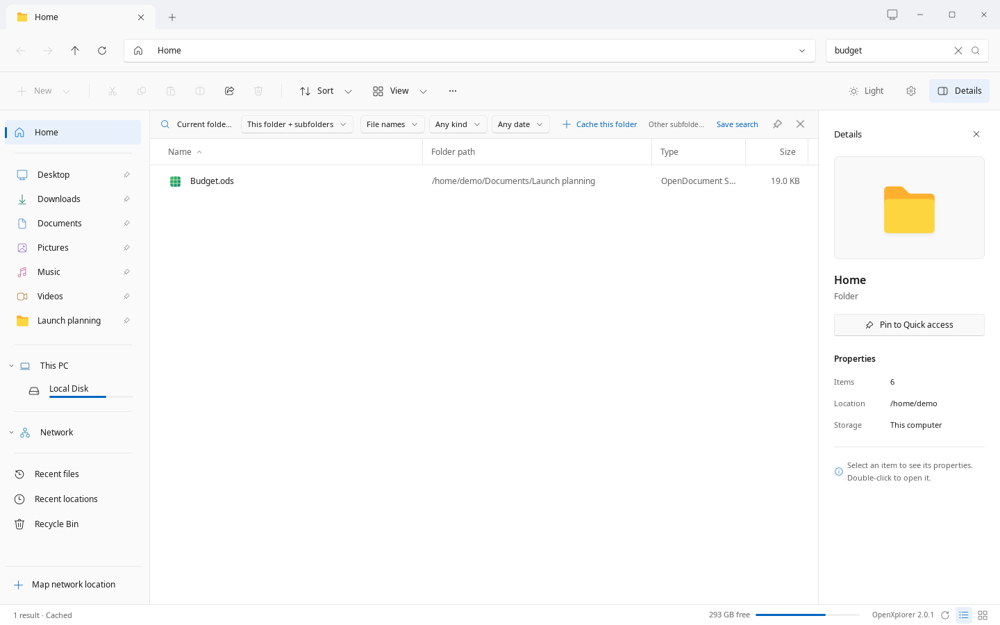

# Search & indexing

Search names and paths from a local index. Keep the boundaries clear.

## Choose what gets indexed

Settings → Search → Indexed folders → Manage lists folders, SMB shares and mounted volumes. Check a root or add a custom path to index its filenames and metadata. The initial scan does not download file contents. Settings → Search → Cache this folder for search indexes the folder you opened Settings from, as a folder's right-click menu does.

Each mounted filesystem is selected separately. Selecting Local Disk does not automatically traverse every other mounted volume.

## Local events, network checks

Local selected directories use filesystem watches while the app is open. Network shares use incremental directory checks, not SMB server-side push notifications. After the app has been closed, reconciliation catches missed changes.

## Results open their real locations

A result includes its parent path. Opening a directory navigates to the actual folder; opening a file checks current metadata and launches an appropriate application. As in Windows 11, a search is a step of the tab’s history: the tab and address bar read Search Results in Documents, Back returns to the folder, Forward to the results, and Back from a folder opened from them shows them again. Emptying the search box, Escape or Close search also goes back to the folder. As in Windows 11, while a search shows the tab reads notes - Search Results in Documents, the words you searched for are marked in the names, and the command bar shows Search options and Close search. Search options chooses All subfolders or Current folder, a Date modified, Kind or Size, and File contents to look inside files too. Settings → Search → Show the search filter bar shows the earlier filter bar above the results instead, with its scope, Kind, Date modified and Size lists, Cache this folder and Save search. The date, kind and size choices narrow the results together: Kind names Windows’ kinds (Document, Folder, Music, Picture, Video), Size uses Windows’ groups, from Empty (0 KB) and Tiny (0 – 16 KB) up to Gigantic (> 4 GB), and Date modified runs from Today to Last year, as in Windows. On the results, … → Pin to Quick access saves the search to the navigation pane, as Windows 11 pins a search. You can also type the options with the words, as in Windows: kind:picture, kind:folder, datemodified:today or datemodified:last month, size:tiny or size:>500 (bytes); typed alone, such as kind:folder, they list every such item of the folder and its subfolders. Stale results can remain when a server is offline.

*The native app, captured with fictional sample files. No live NAS connection.*

## Coverage and limits

The current implementation limits an initial root scan to one million entries, watches up to 8,192 local directories, and uses timed fallback beyond watch coverage. Search displays the first 500 matches and indicates truncation. System/temporary trees, snapshot collections, links and nested mounts are excluded from whole-disk traversal.

## The index stays on your machine

The database contains filenames and paths, which can be sensitive. Disable a root to remove its indexed records. An overlapping root can still contain the same names. The cache is not encrypted and is not an offline copy of file contents.

## Need a nearby file? Just type.

Click the current file list and type SC to select a loaded filename beginning with those letters. This does not filter the view, search subfolders, or contact the NAS for each keystroke. Press Enter to open it.

---

OpenXplorer 2.0.17. Project-authored documentation: AGPL-3.0-only.
